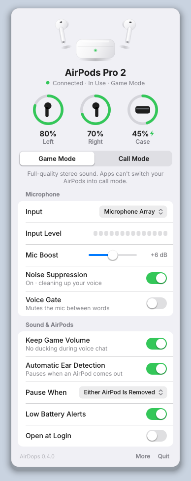
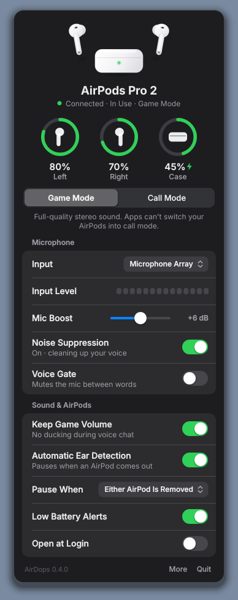
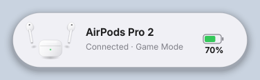
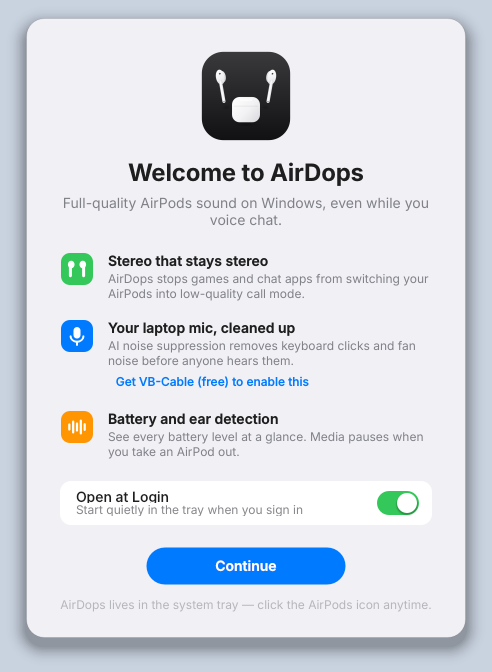

# AirDops

**Full-quality AirPods sound on Windows while you game and voice-chat.**

On Windows, the moment any app opens the AirPods microphone, Windows switches
the AirPods from the high-quality stereo Bluetooth mode (A2DP) to the old
"hands-free" phone-call mode (HFP). Game audio drops to mono, muffled,
phone-call quality. Macs avoid most of this with Apple's own AAC-ELD codec,
which Windows doesn't have and AirPods won't offer to a PC.

No app can change the codec. AirDops does the next best thing automatically,
and only while your AirPods are connected:

| | What AirDops does |
|---|---|
| 🎧 **Full-quality game audio** | Keeps the AirPods in stereo mode by blocking their hands-free mic, so no game, Discord or Teams can drag them into call mode. |
| 🎙️ **A clean mic instead** | Switches your default mic to the laptop mic, with optional **AI noise suppression** (RNNoise) that removes keyboard clicks, fan and room noise before Discord hears you. |
| 🔊 **No volume ducking** | Stops Windows turning your game down by 80% whenever voice chat opens, and restores your setting afterwards. |
| 🔋 **Battery levels** | Left, right and case battery plus charging state in the tray, read from the same Bluetooth LE broadcast iPhones use. Low-battery alerts. |
| 👂 **Ear detection** | Take a bud out and media pauses; put it back and it resumes, like on a Mac. |
| 📞 **Call mode** | One click to use the AirPods mic when you actually want it (e.g. walking away from the desk). |
| ↩️ **Undo everything** | Disconnect or quit and your normal Windows audio setup comes back. Crash-safe: changes are tracked on disk and undone next start. |

<p align="center">
  
  
</p>
<p align="center">
  
  
</p>

## Install

1. From [Releases](../../releases), download **`AirDops-Setup.exe`** (recommended:
   installs for your user only with no admin prompt, adds a Start menu entry,
   and the uninstaller puts your Windows audio back) or
   **`AirDops-portable.zip`** (unzip anywhere and run `AirDops.exe` inside;
   nothing installed).
   Check either against `SHA256SUMS.txt` if you like: `Get-FileHash AirDops-Setup.exe`.
2. Run it. Windows SmartScreen may warn because the files aren't code-signed
   (signing certificates cost money). Choose *More info → Run anyway*. The
   source and the build that produced them are both public in this repo.
3. **For noise suppression (recommended):** install the free
   [VB-Audio Virtual Cable](https://vb-audio.com/Cable/) and reboot. AirDops
   sends your cleaned-up mic into it and makes "CABLE Output" your default
   microphone. Without it, AirDops still works and uses the laptop mic directly.
4. A welcome sheet walks you through it the first time, including
   **Open at Login**.

In Discord, set *Input device* to **Default**, or to "CABLE Output" if you use
noise suppression. Then turn off Discord's own Krisp noise suppression, or keep
it if you like stacking.

## The app

Click the AirPods icon in the system tray to open the panel. It's designed like
macOS Control Center and iOS Settings, follows Windows light and dark mode, and
uses the Inter typeface.

* **Header**: your AirPods, their connection state, and whether they're in your ears.
* **Battery rings** for left, right and case, with charging indicators (green), and orange/red when low.
* **Game Mode / Call Mode** segmented control.
* **Microphone**: pick the input. While noise suppression runs you also get a live **Input Level** meter and a **Mic Boost** slider, plus *Noise Suppression* and *Voice Gate* switches.
* **Sound & AirPods**: *Keep Game Volume* (no ducking), *Automatic Ear Detection* (pause when either or both AirPods come out), *Low Battery Alerts*, *Open at Login*.
* **More**: Bluetooth settings, diagnostics, logs, the settings file, *Restore Windows Audio Settings*.

Press **Ctrl+Alt+M** anywhere, even in a game, to flip between Game and Call
Mode (change or turn it off with `hotkey` in the settings file).

When your AirPods connect, a banner slides in above the tray, like the
iPhone pop-up. Low-battery alerts use the same banner. Right-click the tray icon for a quick menu. The tray glyph is
monochrome and adapts to a light or dark taskbar, with an orange or red dot
when the battery is low. Launching AirDops again just opens the panel.

## Settings file

`%APPDATA%\AirDops\settings.json` (open it from *More → Edit Settings File*; changes apply after restarting AirDops):

| Key | Default | Meaning |
|---|---|---|
| `device_keywords` | `["AirPods"]` | Text that identifies your earbuds in Windows device names. Works with Beats too, e.g. `["AirPods", "Beats"]`. |
| `preferred_mic` | `""` | Part of the name of the mic to use in Game mode (e.g. `"Yeti"`). Empty = laptop mic. |
| `mic_gain_db` | `0` | Extra mic boost after noise suppression (-12 to +24). |
| `auto_pause_trigger` | `"one"` | `"one"`: pause when either bud comes out. `"both"`: only when both do. |
| `low_battery_percent` | `20` | Notification threshold. |
| `hotkey` | `"Ctrl+Alt+M"` | Global shortcut for Game/Call Mode, e.g. `"Ctrl+Shift+F9"`; `""` turns it off. Needs Ctrl, Alt or Win. |
| `ble_min_rssi` | `-70` | Ignore weaker AirPods broadcasts (filters out other people's AirPods). Use `-80` if battery never shows. |

## What AirPods Pro features can and can't work on Windows

✅ Through AirDops: battery for each bud and the case, charging status, ear
detection auto-pause/resume, full-quality stereo while chatting.

✅ Built into the AirPods, works on Windows anyway: press-and-hold the stem to
switch Noise Cancellation ↔ Transparency, stem press for play/pause/skip, and
swipe for volume on Pro 2.

❌ Not possible from a Windows app: Apple's two-way AAC-ELD codec, changing
ANC mode from the PC, Spatial Audio / head tracking, automatic switching
between Apple devices, Conversation Awareness and firmware updates. These rely
on Apple's private protocol, which Windows' Bluetooth stack doesn't expose to
apps.

## Size and speed

v0.4 cut the download by more than half: RNNoise is now built from Xiph's
source with its compact 8-bit model (3.6 MB instead of 14 MB, same output:
see `tests/test_rnnoise_quality.py`), NumPy is replaced by a tiny C helper,
and unused parts of Qt, OpenSSL and the C runtime are left out.

| Download | v0.3.0-beta.1 | v0.4.0-beta.1 |
|---|---|---|
| `AirDops-Setup.exe` | 52.5 MB | 21.6 MB |
| Portable | 70.4 MB (`AirDops.exe`) | 26.6 MB (`AirDops-portable.zip`) |

Measured by `AirDops.exe --bench report.txt` on GitHub's Windows build
machine (no AirPods attached), installed folder build:

| | v0.3.0-beta.1 build | v0.4.0-beta.1 |
|---|---|---|
| Launch to tray icon, first / second launch | 1.79 s / 0.59 s | 1.04 s / 0.57 s |
| CPU while idle in the tray | ≈0.1% of one core | ≈0.1% of one core (now wakes every 2 s, not every 0.35 s) |
| CPU with the panel open | 0.9–1.6% | 0.9–1.3% (the 50 ms level meter only runs while noise suppression is live) |
| Memory while idle (working set / private) | 80 MB / 41 MB | 79 MB / 40 MB |
| Noise suppression, per 10 ms of audio | — | 0.25 ms (about 2.5% of one core) |

Most of the remaining size and memory is Qt and Python themselves. CI fails
if `AirDops-Setup.exe` grows past 21 MiB (`scripts/size_report.py`).

## Testing

See [TESTING.md](TESTING.md) for a 15-minute checklist with real AirPods.

## Troubleshooting

* **Run diagnostics** (*More → Run Diagnostics*, or `AirDops.exe --diagnose`)
  writes a report with device names only (no addresses or ids) that shows
  exactly what AirDops sees and decides.
* **"Couldn't fully block the AirPods mic"**: Windows refused to disable the
  hands-free device. Try running AirDops once as administrator, or do it permanently by
  hand: *Control Panel → Hardware and Sound → Devices and Printers → right-click
  AirPods → Properties → Services → untick "Handsfree Telephony"*.
* **Battery never shows**: open the case near the PC, check Bluetooth is on,
  try `ble_min_rssi: -80`.
* **Undo everything**: *More → Restore Windows Audio Settings*, or quit
  AirDops and run `AirDops.exe --restore`.

## Privacy and security

AirDops makes **no network connections**, has no telemetry, needs no account
and stores nothing outside `%APPDATA%\AirDops` and `%LOCALAPPDATA%\AirDops`
on your PC. See [SECURITY.md](SECURITY.md) for the details.

## Build from source

```powershell
git clone https://github.com/vinay443/AirDops.git
cd AirDops
powershell -ExecutionPolicy Bypass -File scripts\build.ps1   # -> dist\AirDops\AirDops.exe
```

Or run without building: `pip install -r requirements.txt`,
`python scripts\build_rnnoise.py` (needs a C compiler: LLVM clang or Visual
Studio Build Tools; it builds RNNoise from pinned Xiph source), then
`python -m airdops` from `src`.
Tests: `pip install -r requirements-dev.txt` then `python -m pytest`.

### How it works

```
src/airdops/
  core.py              engine: worker thread, BLE monitor, ear detection, actions
  controller.py        Game / Call mode state machine, undo tracking (tested with fakes)
  audio/router.py      which endpoint is which (pure logic, tested)
  audio/endpoints.py   Windows Core Audio COM: list / set default / enable-disable
  audio/ducking.py     the "communications ducking" registry preference
  denoise/             RNNoise binding + realtime WASAPI pipeline + voice gate
  ble/advert.py        AirPods BLE proximity-message parser (tested)
  ble/scanner.py       background bleak scanner, nearest-AirPods filter
  earsense.py          in-ear -> pause/resume decisions (tested)
  media.py             Windows media-session pause/resume
  ui/                  Qt (PySide6) interface: panel, banner, tray, vector artwork
```

Regenerate the screenshots with
`QT_QPA_PLATFORM=offscreen python scripts/render_previews.py docs/screenshots`.

## License

MIT, see [LICENSE](LICENSE). Third-party components are listed in
[THIRD_PARTY_NOTICES.md](THIRD_PARTY_NOTICES.md). AirPods is a trademark of
Apple Inc.; this project is not affiliated with Apple.
